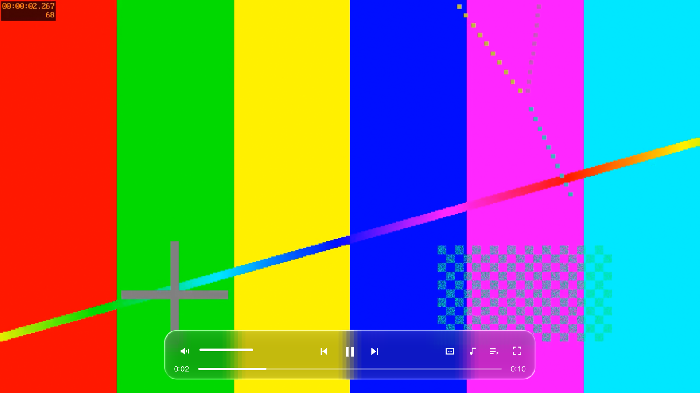
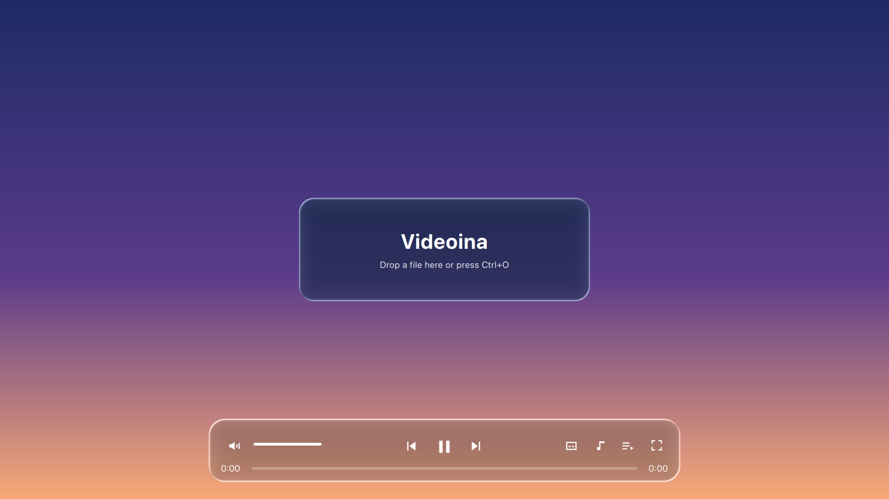

<div align="center">

# Videoina

**An IINA-style video player for Windows and Linux, with a liquid-glass interface.**

[Download](#download) · [Features](#features) · [Shortcuts](#keyboard-shortcuts) · [Building](#building) · [Contributing](CONTRIBUTING.md)

[](LICENSE)




</div>

[IINA](https://github.com/iina/iina) is a well-liked macOS video player, but it is written in Swift on AppKit and runs only on macOS. Videoina brings the same idea to Windows and Linux. It is a thin interface on top of [mpv](https://mpv.io), so it plays nearly anything mpv can, and it uses IINA's keyboard shortcuts. The controls are drawn as "liquid glass": they blur and bend the live video behind them, with a light-catching rim.

Videoina is a separate project. It is not affiliated with IINA or Apple, and it shares no code with IINA apart from its key-binding file (see [NOTICE](NOTICE)).

## Download

Builds will be on the GitHub Releases page once the repository is public:

| System | File | How to run |
|---|---|---|
| Windows 10/11 (x64) | `Videoina-win64.zip` | Unzip and run `videoina.exe`. The build is unsigned, so SmartScreen may ask you to confirm. |
| Linux (x86_64, glibc 2.35+) | `Videoina-x86_64.AppImage` | `chmod +x Videoina-x86_64.AppImage && ./Videoina-x86_64.AppImage` |

## Features

| | |
|---|---|
| **Plays what mpv plays** | MKV, MP4, WebM, HEVC, AV1, ASS/SSA subtitles, multiple audio tracks, chapters |
| **Liquid-glass controls** | Floating control bar, playlist sidebar and menus blur and refract the video in real time (a GPU shader, not a static image) |
| **IINA shortcuts** | IINA's default bindings, with ⌘ mapped to Ctrl |
| **Playlist** | Drop several files at once, or open them with Ctrl+O. Click an entry to jump to it |
| **Tracks** | Subtitle and audio menus list every track, with language and codec |
| **Quiet when watching** | Controls and cursor hide after 2.5 s of no mouse movement, and stay visible while paused |
| **Mouse** | Double-click toggles fullscreen, scroll wheel changes volume |



## Keyboard shortcuts

The most used ones. The full list is in [`config/input.conf`](config/input.conf) (mpv `input.conf` syntax).

| Key | Action |
|---|---|
| Space | Play / pause |
| ← / → | Seek 5 s back / forward |
| Shift+PgUp / PgDn | Seek 10 min |
| ↑ / ↓ | Volume ±5 |
| m or Ctrl+/ | Mute |
| f, Enter / Esc | Fullscreen toggle, on / off |
| Ctrl+← / Ctrl+→ | Previous / next in playlist |
| . / , | Step one frame forward / back |
| Ctrl+[ / Ctrl+] | Half / double speed (Ctrl+\\ resets) |
| v | Show / hide subtitles |
| Shift+Z / Shift+X | Subtitle delay −/+ 0.5 s |
| Ctrl+Shift+S / Ctrl+Shift+A | Next subtitle / audio track |
| Ctrl+s | Screenshot |
| Ctrl+O | Open files |
| q | Quit |

## Building

You need CMake 3.21+, Qt 6.5 or newer (Quick, Quick Controls 2, OpenGL, Shader Tools) and libmpv.

<details>
<summary><b>Linux</b></summary>

```sh
# Debian/Ubuntu; Qt 6.5+ from your distro or the Qt online installer
sudo apt install cmake ninja-build libmpv-dev qt6-base-dev qt6-declarative-dev qt6-shadertools-dev
cmake -S . -B build -G Ninja -DCMAKE_BUILD_TYPE=Release
cmake --build build
./build/videoina video.mkv
```

</details>

<details>
<summary><b>Windows (MSVC)</b></summary>

1. Install Qt 6.8 for MSVC 2022 x64 with the Shader Tools module.
2. Download an `mpv-dev-x86_64-*.7z` from [shinchiro/mpv-winbuild-cmake](https://github.com/shinchiro/mpv-winbuild-cmake/releases) and unpack it to `mpv\`.
3. In a "x64 Native Tools" prompt, make an MSVC import library, then build:

```powershell
"EXPORTS" | Out-File mpv\mpv.def -Encoding ascii
dumpbin /nologo /exports mpv\libmpv-2.dll | Select-String '\s(mpv_\w+)\s*$' |
  ForEach-Object { $_.Matches[0].Groups[1].Value } | Out-File mpv\mpv.def -Append -Encoding ascii
lib /nologo /def:mpv\mpv.def /name:libmpv-2.dll /out:mpv\mpv.lib /machine:x64
cmake -S . -B build -G Ninja -DCMAKE_BUILD_TYPE=Release -DCMAKE_PREFIX_PATH=C:\Qt\6.8.3\msvc2022_64 -DMPV_DIR=%CD%\mpv
cmake --build build
copy mpv\libmpv-2.dll build\
```

</details>

<details>
<summary><b>macOS (development only)</b></summary>

macOS users should use [IINA](https://iina.io). Videoina builds on macOS so it can be worked on there:

```sh
brew install qt mpv cmake
cmake -S . -B build -DCMAKE_PREFIX_PATH="$(brew --prefix qt)"
cmake --build build
./build/videoina.app/Contents/MacOS/videoina video.mkv
```

</details>

<details>
<summary><b>How it works</b></summary>

- `src/mpvitem.cpp`: a Qt Quick item that drives libmpv through its OpenGL render API, so each video frame lands in Qt's scene graph instead of a separate native window. It mirrors mpv properties into QML, and passes key presses to mpv as `keypress` commands so that `config/input.conf` decides what they do.
- `qml/Glass.qml` and `shaders/glass.frag`: each glass panel captures the part of the scene behind it at half resolution. The shader blurs it, bends it inward near the rounded edge (refraction), darkens it slightly so white icons stay readable, and adds a rim highlight. Because the video is part of the scene, the glass reacts to it frame by frame on every graphics backend.
- `qml/ControlBar.qml`, `qml/Playlist.qml`, `qml/Main.qml`: the interface.
- CI (`.github/workflows/build.yml`) builds on Windows and Linux, packages the zip and AppImage, plays a generated test video in each, and uploads a screenshot. Tagging `v*` publishes a release.

</details>

## Limits

- No plugins, picture-in-picture, online video (yt-dlp), seek-bar thumbnails or preferences window yet.
- The glass effect covers Videoina's own controls. The window frame itself is not glass: there is no Mica or Acrylic on Windows, and desktop blur on Linux depends on the compositor.
- Hardware decoding is requested (`hwdec=auto-safe`) but not yet tested on real Windows or Linux GPUs, and neither is HDR output. mpv falls back to software decoding when hardware decoding is unavailable.
- CI tests every build headlessly with software OpenGL. It has not been tried by hand on Windows or Linux hardware yet.
- No animated demo yet.
- x86_64 only, and the builds are not code-signed.

## Licence

GPL-3.0, see [LICENSE](LICENSE). Copyright © 2026 Lucas Van De Weerd. Credits for IINA, mpv and Qt are in [NOTICE](NOTICE).
